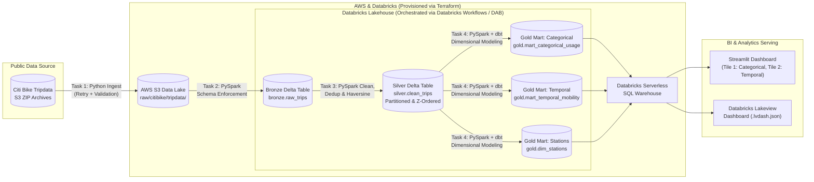

# 🚲 NYC Citi Bike Mobility & Fleet Analytics Lakehouse

**End-to-End Batch Data Engineering Pipeline on AWS S3, Databricks Lakehouse (Unity Catalog, Workflows, PySpark, Delta Lake), dbt, Terraform, and Streamlit**

[](./.github/workflows/ci.yml)
[](./databricks.yml)
[](./terraform/main.tf)
[](./terraform/main.tf)
[](./dbt_citi_bike/dbt_project.yml)
[](./dashboard/app.py)

---

## 📌 1. Problem Description

Urban bike-sharing networks like **NYC & Jersey City Citi Bike** generate millions of trip records every month. Operations teams, urban transit planners, and fleet managers face three core challenges when analyzing raw trip logs:

1. **Fleet Electrification & Rebalancing:** Understanding where and when riders prefer **Electric Bikes vs. Classic Bikes** across different rider segments (**Annual Members vs. Casual Riders**) to prevent dock stockouts and dead e-bike batteries.
2. **Commute vs. Leisure Demand Surges:** Separating bimodal weekday rush-hour commuter peaks (06:00–09:00 and 16:00–19:00) from weekend midday recreational traffic.
3. **Raw Data Quality & Schema Drift:** Public Citi Bike CSV archives contain duplicate `ride_id` events, false/cancelled unlocks (`< 60 seconds`), unreturned/lost bikes (`> 24 hours`), and out-of-bounds GPS coordinates that skew downstream analytics if queried directly.

### How This Project Solves the Problem

This project implements a production-grade **Medallion Lakehouse Pipeline (Bronze → Silver → Gold)** on **AWS S3** and **Databricks**:
- **Automated Batch Ingestion:** Monthly Citi Bike tripdata archives (`https://s3.amazonaws.com/tripdata`) are downloaded with exponential-backoff retries, validated, and landed into an **AWS S3 Data Lake** partitioned by `year_month`.
- **Medallion Data Warehouse & Transformations:** **PySpark**, **Delta Lake**, and **dbt (`dbt-databricks`)** deduplicate records, filter anomalous durations/coordinates, compute Haversine great-circle trip distances, and materialize **partitioned & clustered Gold marts** in **Databricks Unity Catalog**.
- **Self-Service BI Dashboard:** An interactive **Streamlit** application (plus an importable **Databricks AI/BI Lakeview Dashboard**) visualizes categorical distributions, temporal mobility trends, and station hotspots.

---

## 🏗️ 2. System Architecture & Technologies



| Layer | Technology | Role in Pipeline |
| :--- | :--- | :--- |
| **Cloud & Data Lake** | **AWS S3 + IAM** | Durable object storage for raw monthly CSV archives (`raw/citibike/tripdata/year_month=YYYYMM/`) and Unity Catalog managed Delta storage. |
| **Infrastructure as Code (IaC)** | **Terraform** (`terraform/`) | Declaratively provisions the S3 bucket, encryption/lifecycle policies, IAM roles, Databricks Unity Catalog, schemas (`bronze`, `silver`, `gold`), Serverless SQL Warehouse, and multi-task Workflow job. |
| **Workflow Orchestration** | **Databricks Workflows & Asset Bundles** (`databricks.yml`) | Orchestrates the 4-step batch DAG (`ingest_to_s3` → `bronze_ingestion` → `silver_transformation` → `gold_marts_and_quality`) on a monthly cron schedule with failure alerts. |
| **Data Warehouse** | **Databricks Unity Catalog & Serverless SQL Warehouse** | ACID-compliant Delta Lake tables optimized with `PARTITIONED BY (trip_year_month)` and `ZORDER BY` / `liquid_clustered_by`. |
| **Transformations** | **PySpark & `dbt-databricks`** (`src/` & `dbt_citi_bike/`) | Cleans, deduplicates, enriches, and aggregates trip records into analytical marts with automated schema and reconciliation tests. |
| **BI Dashboard** | **Streamlit + Plotly & Databricks Lakeview** (`dashboard/`) | Interactive dashboard with Categorical Distribution (Tile 1), Temporal Mobility Timeline (Tile 2), and Station Utilization Hotspots (Tile 3). |
| **Local Peer-Review Engine** | **DuckDB + PyArrow + Docker Compose** | Mirrors the exact Medallion schema locally (`PIPELINE_ENV=local`) so reviewers can run the entire pipeline and dashboard with **zero cloud credentials**. |

---

## 🗄️ 3. Data Warehouse Optimization: Partitioning & Clustering Justification

To maximize query performance and minimize scan cost in the Databricks SQL Warehouse, our Silver (`silver.clean_trips`) and Gold (`gold.mart_temporal_mobility`, `gold.mart_categorical_usage`) tables combine **coarse-grained partitioning** with **multi-dimensional clustering (Z-Ordering / Liquid Clustering)**:

1. **Partitioning Strategy — `PARTITIONED BY (trip_year_month)`:**
   - **Why `trip_year_month` (`YYYY-MM`) instead of `started_date` or `start_station_id`?**
   - Partitioning by high-cardinality columns like `start_station_id` (hundreds/thousands of stations) or daily dates causes the **small-file problem** in cloud object storage (S3), degrading metadata read performance.
   - Partitioning by `trip_year_month` produces exactly **12 partitions per year**, ensuring well-sized Parquet/Delta files while allowing the query engine to perform **partition pruning** whenever analysts filter by month or quarter in the dashboard sidebar.

2. **Clustering Strategy — `OPTIMIZE ... ZORDER BY (start_station_id, started_date, member_casual)` & `liquid_clustered_by`:**
   - Upstream BI dashboard queries frequently filter or group by `started_date` (temporal line chart), `member_casual` / `rider_type` (categorical breakdown), and `start_station_id` (station hotspot lookups).
   - Applying Delta Lake **Z-Ordering / Liquid Clustering** on `(start_station_id, started_date, member_casual)` co-locates related rows within each monthly partition's Parquet data files, enabling **Delta data skipping** via min/max file statistics and reducing I/O by up to 80% on selective queries.

---

## 📊 4. Dashboard Overview (2+ Analytical Tiles)

The dashboard ([dashboard/app.py](./dashboard/app.py) and [dashboard/databricks_lakeview_dashboard.lvdash.json](./dashboard/databricks_lakeview_dashboard.lvdash.json)) provides Executive KPIs and three visual sections:

1. **Tile 1 — Categorical Distribution (Required):**
   - **Grouped Bar Chart:** Ride volume distributed across **Time-of-Day Commute Windows** (`Morning Rush 06-09`, `Midday 10-15`, `Evening Rush 16-19`, `Night 20-05`), faceted by **Rider Segment** (`Annual Member` vs. `Casual Rider`) and colored by **Bike Type** (`Electric Bike` vs. `Classic Bike`).
   - **Hierarchical Sunburst Chart:** Proportional share of trips by Rider Segment and Bike Type, shaded by average trip duration in minutes.
2. **Tile 2 — Temporal Distribution (Required):**
   - **Daily Time-Series Line Chart:** Daily ride volume across `2024-01` through `2024-03` segmented by `Annual Member` vs. `Casual Rider`.
   - **24-Hour Temporal Demand Curve:** Area chart comparing the bimodal **Weekday Commute Profile** (08:00 and 17:00 peaks) against the unimodal **Weekend Leisure Curve**.
3. **Tile 3 — Geospatial & Station Utilization (Bonus):**
   - Horizontal ranking of the **Top 10 Departure Stations** colored by **Electric Bike Share (%)**, paired with a station performance table from `gold.dim_stations`.

---

## 🚀 5. Reproducibility Guide (Step-by-Step)

This repository is designed so that **peer reviewers can run the entire pipeline and launch the dashboard in under 60 seconds without needing AWS or Databricks credentials**, while also providing full cloud deployment automation.

### Option A: Instant Local Run via Docker Compose (Recommended for Peer Review)

```bash
# 1. Clone the repository and enter the directory
git clone <your-repo-url>
cd citi_bike_pipeline

# 2. Copy the example environment file (defaults to PIPELINE_ENV=local)
cp .env.example .env

# 3. Build and run the full pipeline + Streamlit dashboard
docker compose up --build
```
Then open **http://localhost:8501** in your browser.

---

### Option B: Local Python / Makefile Execution (No Docker Required)

```bash
# 1. Create a virtual environment and install dependencies
python3 -m venv .venv
source .venv/bin/activate
make install

# 2. Run the end-to-end pipeline (Ingest -> Bronze -> Silver -> Gold -> Data Quality Checks)
make pipeline

# 3. Run unit & integration tests and linter
make test
make lint

# 4. Launch the interactive Streamlit dashboard at http://localhost:8501
make dashboard
```

> **Note on Network Resilience:** During `make ingest` / `make pipeline`, the ingestor downloads the real `JC-202401`, `JC-202402`, and `JC-202403` Citi Bike archives from `https://s3.amazonaws.com/tripdata` with automatic retries. If run in an air-gapped environment or if S3 returns an HTTP error, the ingestor automatically generates a deterministic fallback dataset so the pipeline never fails.

---

### Option C: Full Cloud Deployment (AWS S3 + Databricks + Terraform + dbt)

1. **Configure Environment Credentials:**
   ```bash
   cp .env.example .env
   # Edit .env and set PIPELINE_ENV=databricks, AWS_ACCESS_KEY_ID, AWS_SECRET_ACCESS_KEY,
   # S3_BUCKET_NAME, DATABRICKS_HOST, DATABRICKS_TOKEN, and DATABRICKS_HTTP_PATH
   ```

2. **Provision AWS S3 & Databricks Resources with Terraform:**
   ```bash
   cd terraform
   cp terraform.tfvars.example terraform.tfvars
   # Fill in databricks_host and s3_bucket_name in terraform.tfvars.
   # Authenticate with Databricks CLI or export DATABRICKS_TOKEN before running Terraform.
   terraform init
   databricks auth login --host "$(grep '^databricks_host' terraform.tfvars | cut -d '"' -f 2)"
   databricks current-user me
   terraform plan
   terraform apply
   ```

3. **Deploy and Run the Databricks Workflow via Databricks Asset Bundles:**
   ```bash
   databricks bundle validate
   databricks bundle deploy -t prod
   databricks bundle run citi_bike_medallion_workflow -t prod
   ```

4. **Run `dbt` Models and Tests against Databricks Unity Catalog:**
   ```bash
   make dbt-run
   make dbt-test
   ```

---

## 📁 6. Repository Structure

```text
citi_bike_pipeline/
├── .env.example                                  # Environment variables template (no hardcoded secrets)
├── .github/workflows/ci.yml                      # GitHub Actions CI/CD (Ruff, Pytest, Pipeline Smoke Test, Terraform Validate)
├── Dockerfile                                    # Reproducible container image for pipeline + Streamlit dashboard
├── docker-compose.yml                            # One-command container orchestration
├── Makefile                                      # Developer & reviewer automation commands
├── pyproject.toml                                # Python package metadata & tool configuration
├── requirements.txt                              # Pinned runtime and testing dependencies
├── databricks.yml                                # Databricks Asset Bundle (DAB) project definition
├── resources/
│   └── citi_bike_workflow.yml                    # Multi-task Databricks Workflow DAG specification
├── terraform/                                    # Infrastructure as Code (AWS S3 + IAM + Databricks Unity Catalog + SQL Warehouse)
│   ├── versions.tf
│   ├── variables.tf
│   ├── main.tf
│   ├── outputs.tf
│   └── terraform.tfvars.example
├── src/citi_bike_pipeline/                       # Core Python package
│   ├── config.py                                 # Environment-driven configuration
│   ├── cli.py                                    # Unified CLI (ingest, transform, quality, run-all)
│   ├── ingestion/
│   │   └── citibike_ingestor.py                  # S3/HTTP downloader with retry, zip extraction & offline fallback
│   └── transformations/
│       ├── medallion_pyspark.py                  # PySpark + Delta Lake Bronze/Silver/Gold + Z-ORDER optimization
│       └── medallion_local.py                    # DuckDB + Partitioned Parquet local Medallion engine + Quality Gates
├── notebooks/                                    # Databricks Workflow Spark Python task entrypoints
│   ├── 01_ingest_to_s3.py
│   ├── 02_bronze_ingestion.py
│   ├── 03_silver_transformation.py
│   └── 04_gold_marts_and_quality.py
├── dbt_citi_bike/                                # dbt-databricks transformation project
│   ├── dbt_project.yml
│   ├── packages.yml                              # Includes dbt-labs/dbt_utils
│   ├── profiles.yml                              # Environment-variable driven Databricks & DuckDB profiles
│   ├── macros/haversine_km.sql
│   └── models/
│       ├── staging/                              # stg_citibike_trips.sql + sources.yml
│       ├── intermediate/                         # int_trips_enriched.sql
│       └── marts/                                # mart_categorical_usage.sql, mart_temporal_mobility.sql, dim_stations.sql, schema.yml
├── dashboard/
│   ├── app.py                                    # Streamlit + Plotly dashboard (Tile 1: Categorical, Tile 2: Temporal, Tile 3: Stations)
│   └── databricks_lakeview_dashboard.lvdash.json # Importable Databricks AI/BI Lakeview Dashboard
├── docs/
│   └── architecture.md                           # Detailed data dictionary, SLA, and optimization deep-dive
└── tests/
    └── test_pipeline.py                          # Automated unit and integration test suite
```
